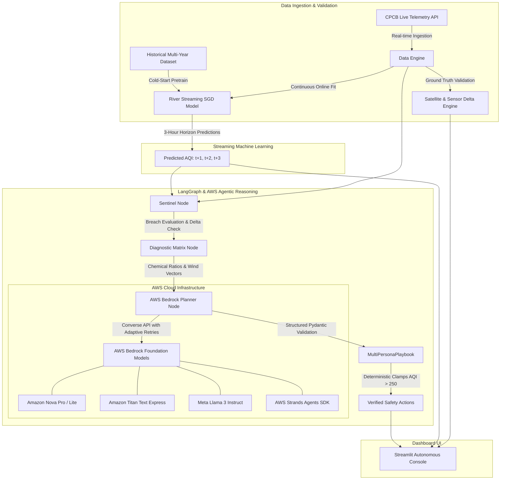

# 🌍 AeroGraph: Autonomous Air Quality Orchestrator & Predictive Response Engine

[](https://www.python.org/)
[](https://aws.amazon.com/bedrock/)
[](https://aws.amazon.com/)
[](https://langchain-ai.github.io/langgraph/)
[](https://streamlit.io/)
[](https://riverml.xyz/)
[](https://opensource.org/licenses/MIT)

> **AeroGraph** is an enterprise-grade, edge-to-cloud atmospheric safety and civic intelligence orchestrator. It couples **real-time CPCB telemetry**, **online streaming machine learning (River)**, **LangGraph multi-agent reasoning**, and **AWS Bedrock foundation models (Amazon Nova, Amazon Titan, Meta Llama 3)** to forecast particulate spikes and automatically synthesize hyper-localized, persona-specific civic mitigation playbooks.

---

## 🏛️ System Architecture

AeroGraph operates as a closed-loop autonomous system where real-time atmospheric measurements are ingested, forecasted ahead using incremental streaming models, evaluated for anomaly breaches, diagnosed for physical emission sources, and translated into binding action protocols.



---

## ☁️ AWS Cloud Services & AI Integration

AeroGraph leverages state-of-the-art AWS artificial intelligence and cloud SDKs to guarantee low-latency, resilient, and enterprise-grade reasoning:

### 1. Amazon Bedrock Runtime (`bedrock-runtime`)
- **Converse API Integration**: Operates via `ChatBedrockConverse` using unified conversational messaging for consistent multi-turn reasoning and tool invocation.
- **Cross-Region Inference Profiles**:
  - **US Profiles**: `us.amazon.nova-lite-v1:0`, `us.amazon.nova-pro-v1:0` with fallback to `amazon.nova-lite-v1:0` and `amazon.nova-pro-v1:0`.
  - **APAC Profiles**: `apac.amazon.nova-pro-v1:0` and `apac.amazon.nova-lite-v1:0` in `ap-southeast-2` to eliminate cross-continental latency.
  - **Foundation Model Redundancy**: Ordered fallback spanning **Amazon Titan Text Express** (`amazon.titan-text-express-v1`), **Meta Llama 3 8B Instruct** (`meta.llama3-8b-instruct-v1:0`), and **Mistral 7B** to guarantee zero downtime under quota constraints.
- **Structured Pydantic Output**: Direct JSON schema binding enforcing strict typing on the `MultiPersonaPlaybook` schema.

### 2. AWS Strands Agents SDK
- Coordinates pipeline telemetry, agent state transitions, and dynamic persona dispatch across institutional stakeholders.

### 3. Adaptive Boto3 Client Engine
- Configured with `botocore.config.Config(retries={"max_attempts": 3, "mode": "adaptive"})` to dynamically back off against burst limits and API throttling.

### 4. Zero-Downtime Offline Cache Fallback
- If cloud connectivity is lost or daily token ceilings are reached, AeroGraph seamlessly fails over to `cache_last_plan.json`, contextually adjusting plans to local meteorology without interrupting the live operator console.

---

## 🚀 Key Features

### 1. Real-Time Telemetry & 10 Metropolitan Coverage
AeroGraph ingests real-time CPCB telemetry across **10 major Indian urban centers**:
- **Delhi** (28.6139° N, 77.2090° E)
- **Mumbai** (19.0760° N, 72.8777° E)
- **Pune** (18.5204° N, 73.8567° E)
- **Bengaluru** (12.9716° N, 77.5946° E)
- **Kolkata** (22.5726° N, 88.3639° E)
- **Chennai** (13.0827° N, 80.2707° E)
- **Hyderabad** (17.3850° N, 78.4867° E)
- **Ahmedabad** (23.0225° N, 72.5714° E)
- **Lucknow** (26.8467° N, 80.9462° E)
- **Jaipur** (26.9124° N, 75.7873° E)

### 2. Streaming Machine Learning (`River`)
- **Incremental Online Training**: Models train observation-by-observation using online stochastic gradient descent (`river.linear_model.LinearRegression` with `StandardScaler`).
- **Cold-Start Warmup**: Pre-trained on multi-year hourly Indian atmospheric archives (`dataset/delhioct2022-2026open-meteo-28.60N77.20E214m.csv`).
- **Forward Multi-Step Horizon**: Generates continuous $t+1, t+2, t+3$ hour ahead forecasts.
- **Dynamic Scorecard**: Benchmarks online model MAE in real time against a persistence baseline.

### 3. Scientific Source Vector Diagnostics
- Calculates fine-to-coarse particulate ratios ($\text{PM}_{2.5} / \text{PM}_{10}$).
- Analyzes chemical tracers ($\text{NO}_2$ from vehicular combustion, $\text{SO}_2$ from industrial emissions).
- Triangulates upwind compass bearings ($0^\circ - 360^\circ$) to identify emission origins (e.g., North-Northwest biomass corridors, local industrial belts).

### 4. Autonomous Multi-Persona Response Playbooks
Generates contextual, actionable directives tailored to 4 critical stakeholder personas:
- 🧑‍💼 **Citizen & Commuter**: Imminent departure window alerts before peaks, route recommendations naming actual arterial roads and metro corridors, and respiratory protective guidance.
- 🏫 **Schools & Educational Campuses**: Binding recess adjustments (Normal, Shift Indoors, Suspend Outdoor Activities) and classroom envelope sealing/ventilation schedules.
- 🏢 **Facilities & Commercial HVAC**: Air handler unit (AHU) damper recirculation percentages (100% Fresh Air, 80% Recirc + MERV-13, Isolated Indoor Loop) and high-static pre-scrub purge cycles.
- 🏛️ **Municipal Governance & Field Mitigation**: Target corridor deployments (anti-smog mist cannons, mechanical sweepers, diesel generator set halts, and heavy freight diversions).

### 5. Deterministic Safety Clamps
Public health rules are non-negotiably enforced via deterministic software clamps:
- **AQI > 250 or Consecutive Breach Anomaly**: Commuter mask **MUST** clamp to `N95 / FFP2 Respirator`, School Recess **MUST** clamp to `Suspend Outdoor Activities`, HVAC **MUST** clamp to `Isolated Indoor Loop` (60 min pre-scrub).
- **AQI 101 to 250**: Commuter mask clamped to `3-Ply Surgical`, Recess shifted indoors, HVAC to `80% Recirculation + MERV13`.
- **AQI <= 100**: Normal outdoor schedule, unrestricted airflow.

---

## 📂 Project Structure

```
AeroGraph/
├── .env.example              # Sample environment template
├── .gitignore                # Git exclusions (credentials, pycache)
├── app.py                    # Primary Streamlit dashboard & real-time UI
├── cache_last_plan.json      # Certified offline fallback response cache
├── requirements.txt          # Python dependency specifications
├── README.md                 # Project documentation
│
├── data/
│   └── delhi_severe_nov2024.csv  # Reference validation sample
│
├── dataset/
│   ├── delhioct2022-2026open-meteo-28.60N77.20E214m.csv
│   └── mumbaioct2022-2026open-meteo-19.10N72.90E8m.csv
│
├── graph/
│   ├── __init__.py
│   ├── diagnostic.py         # Scientific diagnostic matrix & wind vectoring
│   └── workflow.py           # LangGraph StateGraph & Bedrock LLM orchestrator
│
├── ml/
│   ├── __init__.py
│   └── online_model.py       # River incremental learning & 3h forecasting
│
├── tools/
│   ├── __init__.py
│   └── data_engine.py        # CPCB live telemetry ingestion & validation
│
└── tests/
    └── test_suite.py         # Acceptance test suite (7 verification criteria)
```

---

## 🛠️ Installation & Setup

### 1. Prerequisites
- **Python**: 3.10, 3.11, or 3.12
- **AWS Account**: IAM credentials with Bedrock model invoke permissions (`bedrock:InvokeModel`)

### 2. Clone Repository
```bash
git clone https://github.com/SaitejWable/AeroGraph.git
cd AeroGraph
```

### 3. Create & Activate Virtual Environment
```bash
# Windows (PowerShell)
python -m venv .venv
.venv\Scripts\Activate.ps1

# Linux / macOS
python3 -m venv .venv
source .venv/bin/activate
```

### 4. Install Dependencies
```bash
pip install -r requirements.txt
```

### 5. Configure Credentials
Copy `.env.example` to `.env` and fill in your AWS credentials:
```bash
cp .env.example .env
```
Inside `.env`:
```ini
AWS_ACCESS_KEY_ID="your_aws_access_key_id"
AWS_SECRET_ACCESS_KEY="your_aws_secret_access_key"
AWS_DEFAULT_REGION="us-east-1"
APP_ENV="development"
DEFAULT_TIMEZONE="Asia/Kolkata"
```

---

## 🧪 Verification & Testing

Run the automated acceptance suite verifying all 7 architectural criteria:
```bash
python tests/test_suite.py
```
**Test Coverage Includes:**
1. 10 Metropolitan configuration validation
2. Live ingestion across target cities
3. Ground-truth cross-source validation
4. 30-day historical trend retrieval
5. River ML pre-training and progressive online fit
6. Deterministic post-LLM public health safety clamps
7. Resilient cache fallback under invalid keys / quota throttling

---

## 💻 Running the Application

Launch the AeroGraph Streamlit console locally:
```bash
streamlit run app.py
```
Open your browser at `http://localhost:8501`.

---

## 📜 License

This project is licensed under the MIT License — see the [LICENSE](LICENSE) file for details.
